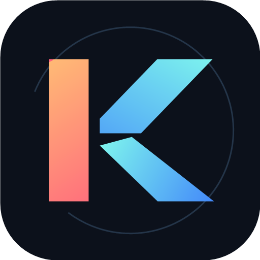
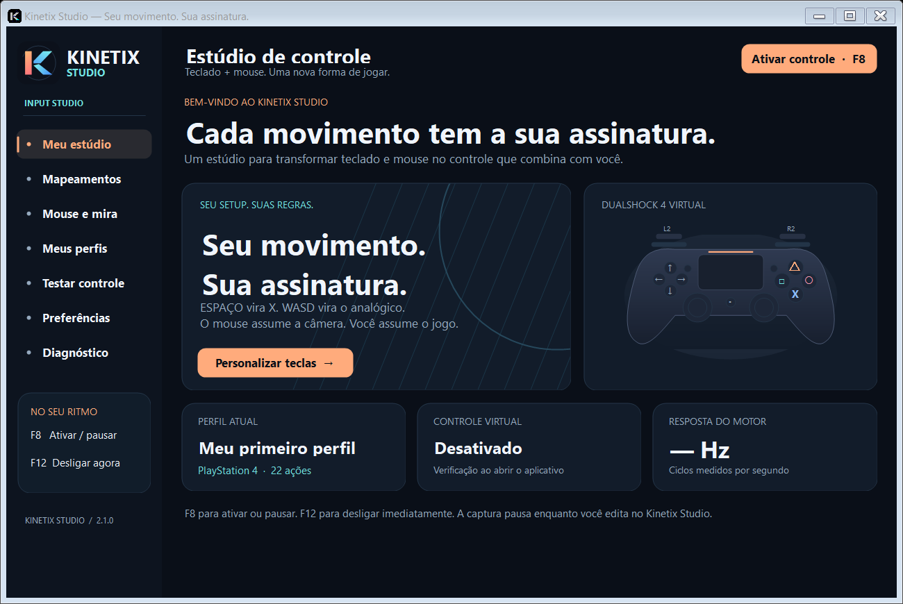

<p align="center"></p>
<h1 align="center">Kinetix Studio</h1>
<p align="center"><strong>Seu movimento. Sua assinatura.</strong><br/>Teclado e mouse transformados em um controle virtual para Windows.</p>
<p align="center">Windows x64 · PS4 / Xbox 360 · Português · Offline · Versão 2.3.0</p>



## Começar

1. Baixe KinetixStudio-Setup.exe ou o ZIP em [Releases](https://github.com/Duailibe32/kinetix-studio/releases/latest) e instale ou extraia a pasta inteira.
2. Abra **KinetixStudio.exe**. Mantenha `ViGEmClient.dll` ao lado do executável.
3. Escolha um perfil ou preset. Em **Preferências**, selecione PS4 ou Xbox 360 e, opcionalmente, o executável do jogo.
4. Pressione **F8** para ativar e volte ao jogo. **F8** pausa; **F12** desliga e libera as entradas.
5. Use **Testar controle** para ver analógicos, botões e o último comando enviado.

O aplicativo começa desativado. A captura pausa dentro do estúdio, exceto na tela explícita de teste. Editar um ajuste pausa o controle. Fechar o programa remove o dispositivo virtual. O programa não instala drivers automaticamente.

## O que está incluído

- Controles virtuais PlayStation 4 e Xbox 360 pela API pública do ViGEmClient.
- Editor pesquisável para 22 ações: botões, gatilhos, direcionais e movimento.
- Teclas, botões laterais do mouse e roda para cima/baixo como entradas.
- WASD com diagonais normalizadas; caminhada lenta por modificador configurável.
- Mouse para analógico direito ou esquerdo; sensibilidade, proporção vertical, inversão, suavização, curva e zona morta de saída.
- Presets de **Precisão FPS**, **Exploração** e **Corrida**.
- Preset adicional **Mira estável**, filtro de ruído radial e sensibilidade separada ao manter LT/L2 pressionado. Os ajustes ficam em **Mouse e mira**, ao rolar a página para baixo. Perfis antigos mantêm filtro zero e sensibilidade ao mirar em 100%.
- Criar, duplicar, selecionar, excluir, importar e exportar perfis JSON.
- Bloqueio opcional das teclas remapeadas e do cursor; filtro de captura por executável.
- Intervalos solicitados de 4, 8 ou 16 ms, com ciclos reais medidos no estúdio.
- Bandeja do sistema, minimização opcional, verificação do driver e eventos recentes.

## Padrão de teclas

| Entrada | PS4 | Xbox 360 |
|---|---|---|
| ESPAÇO | X | A |
| WASD | Analógico esquerdo | Analógico esquerdo |
| Movimento do mouse | Analógico direito | Analógico direito |
| Mouse esquerdo / direito | R2 / L2 | RT / LT |
| CTRL esq. / R / E | Círculo / Quadrado / Triângulo | B / X / Y |
| Q / F | L1 / R1 | LB / RB |
| SHIFT esq. / C | L3 / R3 | LS / RS |
| TAB / ESC | SHARE / OPTIONS | BACK / START |
| Setas | Direcional | Direcional |
| HOME / T | PS / touchpad | GUIDE / indisponível |
| ALT esquerdo | Caminhada a 45% em perfis novos | Caminhada a 45% em perfis novos |

A roda fica sem mapeamento por padrão. Você pode atribuí-la no editor. O preset Corrida usa W para acelerar e S para frear. Cada jogo define o significado dos botões; “pular” depende do mapeamento do jogo.

## Requisitos e limites

**Windows x64**, .NET Framework 4.8 e **ViGEmBus** instalado. O projeto ViGEm foi arquivado: consulte apenas as [releases oficiais do driver](https://github.com/nefarius/ViGEmBus/releases) e o [comunicado do autor](https://docs.nefarius.at/projects/ViGEm/End-of-Life/). O driver é externo e não faz parte do ZIP.

O Kinetix Studio é um aplicativo desktop; não é um aplicativo Android/iOS. A janela é redimensionável em computadores e tablets Windows. Não há banco de dados ou autenticação: os dados são arquivos locais. Nenhum serviço pago, conta online ou telemetria é necessário para usar o programa.

O mouse usa deslocamentos do cursor do Windows, não Raw Input. A velocidade e a aceleração do Windows afetam sua resposta. O destino é um analógico, com os limites do próprio jogo. Jogos que leem teclado/mouse por outros caminhos podem continuar recebendo entradas nativas mesmo com bloqueio. Jogos elevados podem restringir hooks. A compatibilidade com um título específico ou sistema anticheat não é garantida.

Não há macros, giroscópio, vibração, ocultação de controle físico ou toque por coordenadas. O touchpad é um botão digital. Nenhum componente do reWASD é carregado.

## Seus arquivos

Os dados ficam em `%LOCALAPPDATA%\KinetixStudio`, separados da instalação:

- `profiles/`: perfis JSON validados; gravação atômica.
- `selected.txt`: perfil escolhido.
- `desktop.json`: preferência da bandeja.
- `kinetix.log`: eventos locais com rotação por tamanho.

Os perfis da versão 1.0 continuam compatíveis. A antiga pasta `data` adjacente é importada uma vez, preservando os originais e os arquivos já existentes em AppData. Conflitos recebem cópia em `migration-backups`. O instalador aceita indicar uma pasta `data` externa. Atualização e desinstalação preservam dados pessoais. Perfis antigos mantêm ALT livre até configurar a caminhada. Veja [medições e otimização](docs/OPTIMIZATION.md).

A versão 2.1 adota o nome **Kinetix Studio**. Os executáveis anteriores não são necessários para abrir a nova versão. O histórico `veylora.log`, quando presente, é copiado para `kinetix.log` sem apagar o original ou sobrescrever um histórico novo. Feche a versão anterior antes de ativar o novo aplicativo.

## Compilar e testar

```powershell
pwsh -File .\build.ps1
.\.build\tests\KinetixStudio.Tests.exe
```

O build restaura a biblioteca nativa a partir do pacote oficial versionado, validando seu SHA-256. Não exige SDK .NET ou download durante a compilação. Use PowerShell 7 em Windows com .NET Framework 4.8.

```powershell
# Cria temporariamente controles virtuais. Execute fora de uma partida.
.\.build\tests\KinetixStudio.Tests.exe --integration

# Gera o pacote portátil e seu SHA-256.
pwsh -File .\build.ps1 -Package

# Inclui instalador; primeira execução prepara Inno Setup oficial verificado.
pwsh -File .\build.ps1 -Package -Installer

# Build isolado para conferir uma cópia limpa.
pwsh -File .\build.ps1 -OutputDir artifacts\clean
```

A automação Windows compila, executa os testes sem driver e preserva o ZIP como artefato. Testes de integração com driver são locais. Veja [validação](docs/VALIDATION.md), [arquitetura](docs/ARCHITECTURE.md), [histórico](CHANGELOG.md) e [contribuição](CONTRIBUTING.md).

## Identidade e licenças

A logo está em SVG, PNG e ICO em `assets/brand`. O projeto privado é mantido por **Duailibe32**, com todos os direitos reservados. As licenças de terceiros estão em [THIRD-PARTY-NOTICES.md](THIRD-PARTY-NOTICES.md). O Kinetix Studio não é afiliado a Sony, Microsoft, Nefarius ou reWASD.
